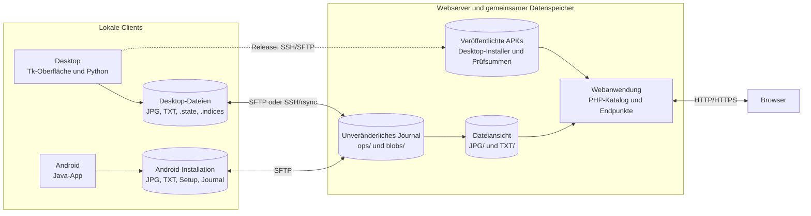
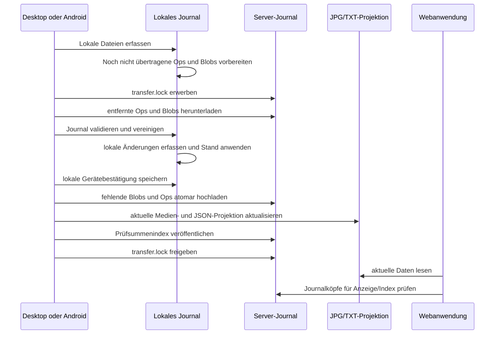
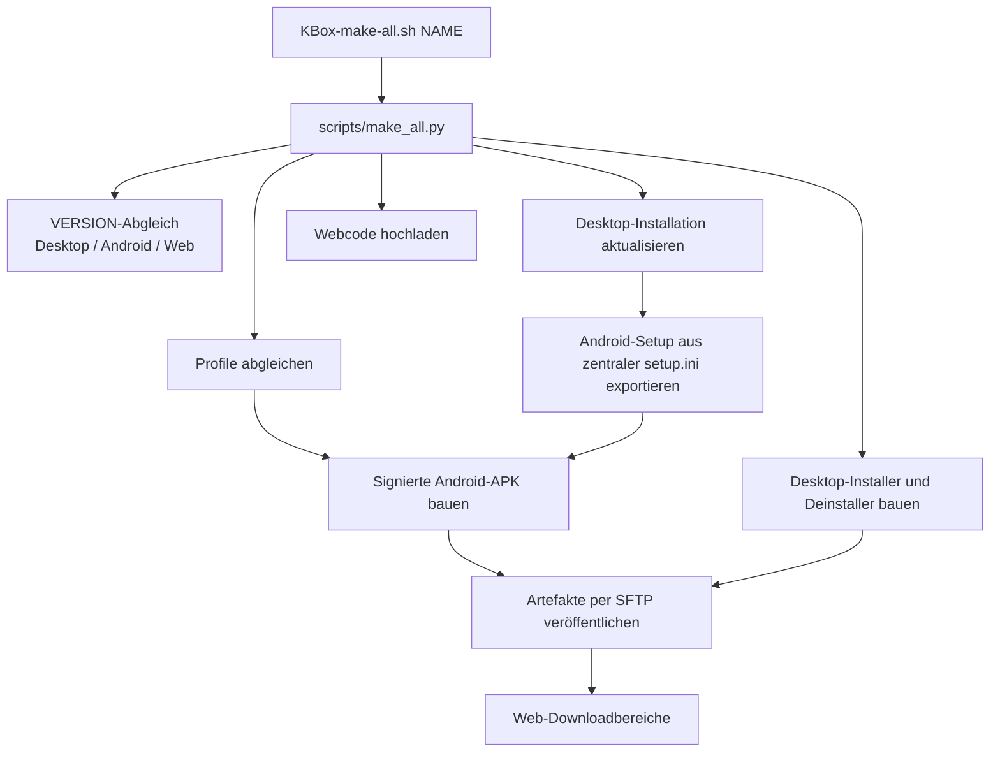

# ChaosBox – Systemdokumentation

Diese Dokumentation beschreibt Desktop, Android und Web als ein Gesamtsystem: die wichtigsten Bausteine, ihre Zuständigkeiten und die Schnittstellen, über die sie Konfiguration, Daten und Veröffentlichungen austauschen. Das Synchronisationsformat ist in [`SYNC-PROTOCOL.md`](SYNC-PROTOCOL.md) ausführlich festgehalten; dieses Dokument erklärt, wie die Komponenten darin zusammenspielen.

## 1. Überblick

ChaosBox besteht aus drei Anwendungen in drei gemeinsam versionierten Projekten:

| Projekt | Aufgabe | Zentrale Bausteine |
| --- | --- | --- |
| `chaosbox-desktop` | Bilder und Datensätze am Desktop verwalten, synchronisieren und Installationspakete bauen | Tk-Oberfläche, Python-Domänenlogik, Journal und Transport |
| `chaosbox-android` | Bilder und Datensätze mobil verwalten und synchronisieren | Android-Oberfläche, lokale Speicherverwaltung, Journal und SFTP |
| `chaosbox-kner-at` | Synchronisierte Daten im Web anzeigen und Installer/APKs bereitstellen | PHP-Anwendung, Datenkatalog, Bildzugriff und Download-Endpunkte |

Die Clients schreiben nicht in eine zentrale Datenbank. Jeder Client besitzt eine lokale Installation und gleicht Änderungen über ein unveränderliches Journal auf dem Webserver ab. Die Webanwendung liest die daraus erzeugten Dateien und stellt sie dar.



Die Darstellung `JPG/` und `TXT/` ist eine Projektion des zusammengeführten Journalstands. Die maßgebliche Änderungshistorie liegt in `TXT/.chaosbox-sync/ops/` und `blobs/`, nicht in den aktuellen JPEG- oder JSON-Dateien.

## 2. Komponenten und Zuständigkeiten

### 2.1 Desktop

Der Desktop ist eine Python-/Tk-Anwendung für Ubuntu. Die Einstiegsschicht in `src/app.py` verwaltet Fenster, Dialoge, Medienauswahl, Bearbeitung und Hintergrundaktionen. `src/core.py` bildet die Domänenschicht: Sie liest `setup.ini`, ermittelt Profile, verwaltet Medien und JSON-Datensätze, baut Suchindizes und koordiniert Synchronisation. `src/chaos_sync.py` implementiert den plattformübergreifenden Journalkern. `src/sync_transport.py` überträgt Journaldateien und aktualisiert die Dateiprojektion.

Die ausführbaren Einstiege liegen in `scripts/`: etwa `run-desktop.sh`, `install-desktop.sh`, `sync-data.py` sowie der Gesamtbuild `make_all.py`. Der Aufruf `KBox-make-all.sh` bleibt im Projektstamm und delegiert an `scripts/make_all.py`.

Eine Desktop-Installation besitzt einen eigenen Verzeichnisstamm. Die Boxen/Profile liegen darunter; Setup, Zugangsdaten, UI-Zustand und Suchindex werden installationsbezogen gehalten.

```text
<Desktop-Installation>/
├── setup.ini
├── .installation-id
├── .state/credentials/       # eigener SSH-Schlüssel und bekannte Hosts
├── .indices/                 # lokaler Suchindex
└── <Profil>/
    ├── JPG/                  # lokale Medien
    └── TXT/                  # lokale JSON-Datensätze und Journal
        └── .chaosbox-sync/
```

### 2.2 Android

Android ist eine Java-Anwendung. `EditorActivity` koordiniert die Oberfläche. `AppProfiles`, `StoragePaths` und `InstallationFiles` lesen die Konfiguration und binden Dateien an genau eine Installation. `SyncStore` verwaltet das lokale Journal; `SyncSftp` tauscht Journal und Projektionen mit dem Server aus. `UploadFiles` steuert Verbindung, Abbruch und Fehlerweitergabe.

Jede Android-Installation besitzt ihr eigenes Verzeichnis unter dem ausgewählten Speicherstamm. Die Installationsidentität und die Zugangsdaten werden dort verwaltet. Eine frische Installation verbindet sich nicht automatisch mit einem beliebigen Desktop-Ziel: Sie benötigt eine explizite `Installation`-Konfiguration.

### 2.3 Web

Die PHP-Anwendung ist die Anzeige- und Download-Schicht. `ChaosBoxSync` liest und prüft Journalinformationen; `ChaosBoxCatalog` bereitet die synchronisierten Boxen für die Webansicht auf. `public/index.php` liefert die Hauptansicht, `public/image.php` bedient kontrollierte Bildabrufe. `public/apk.php` und `public/installer.php` listen beziehungsweise liefern veröffentlichte Installationspakete.

Die Webanwendung ist kein Schreibclient des Journals. Sie liest die synchronisierten Dateien und aktualisiert bei Bedarf ihren Webkatalog unter `.indices/`. Installer und APKs liegen getrennt vom Profildatenbestand unter `storage/desktop/` beziehungsweise `storage/apk/`.

### 2.4 Build- und Veröffentlichungsstrecke

`scripts/make_all.py` koordiniert den Gesamtbuild. Der Ablauf aktualisiert zunächst den Desktop der gewählten Installation, lädt den Webcode hoch, gleicht die konfigurierten Profile ab, erzeugt aus dem Desktop-Setup die Android-Setupdatei, signiert eine APK und baut Desktop-Installer sowie Deinstaller. Die fertigen Artefakte werden per SFTP in die Downloadbereiche des Webservers übertragen.

Alle drei Projekte führen eine gemeinsame Root-Datei `VERSION`. Der Gesamtbuild prüft, dass die Versionswerte übereinstimmen. Android verwendet diese Version als `versionName`; `versionCode` wird zusätzlich bei Android-Updates erhöht.

## 3. Datenmodell und gemeinsamer Speicher

### 3.1 Profile und Setup

`setup.ini` ist die gemeinsame Konfigurationsschnittstelle. `[App]` enthält geerbte Anwendungseinstellungen; jede `[Box]`-Sektion beschreibt ein Profil, darunter Titel und Feld-/Kategorieeinstellungen. `[SSH]` legt gemeinsame Serververbindung und Standardwerte fest. `[SSH.<Profil>]` kann Verbindungswerte profilbezogen überschreiben.

Der Desktop-Gesamtbuild verwendet das Setup der konkreten Desktop-Installation. Er exportiert daraus eine Android-kompatible Setupdatei und kommentiert Desktop-spezifische Einträge aus. Dadurch teilen die Apps Profilnamen und fachliche Felder, obwohl sie unterschiedliche Oberflächen haben.

### 3.2 Installations- und Profilpfade

Der entfernte Namensraum wird aus Webinstallation, Installationskennung und Profilkennung gebildet:

```text
<WebInstallation>/storage/installations/<Installation>/profiles/<RemoteProfile>/
├── JPG/                         # aktuelle Medienprojektion
└── TXT/
    ├── <Datensatz>.json         # aktuelle Datensatzprojektion
    └── .chaosbox-sync/
        ├── ops/<revision>.op    # unveränderliche Änderungsoperationen
        ├── blobs/<sha256>.blob  # vollständige Medienversionen
        ├── checksums.json       # optionaler Prüfsummenindex
        └── transfer.lock        # gemeinsamer Transfer-Lock
```

Desktop leitet `Installation` standardmäßig aus einer lokalen Installationsgeneration, Rechneridentität und Pfad ab. Android setzt die Zielinstallation explizit in der Konfiguration. Der gleiche fachliche Datenbestand muss auf allen Clients dieselbe Kombination aus `WebInstallation`, `Installation` und `RemoteProfile` verwenden.

Der lokale `.installation-id`-Wert bindet den Client an seine aktuelle Installation. Wird das Installationsverzeichnis gelöscht und neu angelegt, entsteht eine neue Generation und damit ein anderer entfernter Namensraum. Alte Journale werden nicht automatisch wiederverwendet.

## 4. Synchronisation und Konflikte

### 4.1 Journalprinzip

Eine Änderung ist eine unveränderliche Operation mit Objekt-ID, Revisions-ID, Vorgängerrevisionen, Typ, Pfad und Aktion. Typen sind `record`, `media` und `device`. Medieninhalte werden nach SHA-256 adressiert und als Blobs übertragen. Revisionen bilden einen gerichteten Verlauf; Zeitstempel dienen nur der Anzeige und entscheiden keinen Konflikt.

Ein fehlendes lokales File ist kein Löschsignal. Löschungen werden ausdrücklich als Journaloperation gespeichert. Parallele Änderungen bleiben als mehrere Journalköpfe erhalten, bis ein Benutzer eine Version auswählt. Eine Auswahl erzeugt wiederum eine neue Revision, die alle betroffenen Köpfe als Vorgänger enthält.

### 4.2 Ablauf eines Abgleichs



Der Transfer-Lock schützt die gemeinsame Serveränderung vor konkurrierenden Transfers. Downloads werden zuerst zwischengespeichert und geprüft. Operationen und Medien werden nicht durch Spiegel-Synchronisation mit Löschoption entfernt. Bei Abbruch kann der Austausch wiederholt werden; unvollständige temporäre Dateien gelten nicht als abgeschlossene Änderung.

Nach dem Austausch wenden die Clients den zusammengeführten Journalstand lokal an und aktualisieren ihre Indizes. Die Webanwendung liest denselben Stand. Ein Konflikt stoppt die Datenhaltung nicht: Alle Revisionen bleiben erhalten und sind über Desktop beziehungsweise Android ausdrücklich auflösbar.

### 4.3 Lokale und entfernte Zustände

| Zustand | Lokal | Auf dem Server | Übertragung |
| --- | --- | --- | --- |
| Ops und Medien-Blobs | Ja | Ja | Ja, unveränderlich vereinigt |
| aktuelle JPG-/JSON-Dateien | Ja | Ja | Als Projektion aus dem Journal hergestellt |
| Geräte-ID, Konfliktansicht und Papierkorb | Ja | Nein | Nein |
| Installationssetup, SSH-Schlüssel und UI-Zustand | Ja | Nein | Nein |
| Prüfsummenindex/Manifest | Ja | Optional auch serverseitig | Prüfbeschleunigung; kein Ersatz für Validierung |

Näheres zu Operationen, Validierung, Wiederherstellung, Konfliktauflösung und Sperren steht in [`SYNC-PROTOCOL.md`](SYNC-PROTOCOL.md).

## 5. Schnittstellen

| Schnittstelle | Produzent → Verbraucher | Vertrag |
| --- | --- | --- |
| `setup.ini` | Nutzer/Build → Desktop und Android | INI mit `[App]`, wiederholten `[Box]`-Sektionen sowie `[SSH]` und optional `[SSH.<Profil>]` |
| lokale Dateien | Desktop/Android → jeweilige App | Medien in `JPG/`, strukturierte Datensätze in `TXT/`; Datensatz-IDs und Revisionen werden erhalten |
| Synchronisationsjournal | Desktop/Android ↔ Server | Dateien unter `.chaosbox-sync/`; validierte JSON-Ops und SHA-256-Blobs, kein Zeitstempel-Merge |
| SSH/SFTP | Desktop/Android → Server | SSH-Authentisierung mit bekanntem Hostschlüssel; Android nur SFTP, Desktop SFTP oder SSH-basierter Tar-/rsync-Transport |
| HTTP/HTTPS | Browser → Web | PHP-Endpunkte für Ansicht, Bilder, APK- und Installerdownloads; der Browser verändert das Journal nicht |
| Build-Übergabe | Desktop-Build → Android | gemeinsame `VERSION`, temporäres Setup über `KBOX_SETUP_FILE`, Installationsname und benötigte Android-Assets |
| Veröffentlichung | Desktop-Build → Webserver | Webcode per Uploadskript; fertige APKs unter `storage/apk/`, Desktop-Pakete und Prüfsummen unter `storage/desktop/` |

Die SSH-Identität und der bekannte Hostschlüssel sind lokale Zugangsdaten. Unbekannte Hostschlüssel werden abgelehnt. Der Webserver muss den Profildatenbestand lesen können; Schreibrechte der Webanwendung sind auf ihren Katalog-/Cachebereich begrenzt.

### HTTP-Endpunkte

| Endpunkt | Rolle |
| --- | --- |
| `public/index.php` | HTML-Ansicht der veröffentlichten Profile und Suche |
| `public/image.php` | Kontrollierter Abruf eines synchronisierten Bildes |
| `public/apk.php` | APK-Downloadseite und -Auslieferung |
| `public/installer.php` | Desktop-Installer und Prüfsummen zur Verfügung stellen |

Die Clients synchronisieren nicht über diese HTTP-Endpunkte, sondern direkt über SSH/SFTP. HTTP ist die Leseschnittstelle für Webnutzer und Downloads.

## 6. Gesamtbuild als Schnittstellenkette



Der Build bricht ab, wenn die Produktversionen nicht übereinstimmen, ein Installationssetup fehlt oder die Boxen nicht dieselbe Serveridentität verwenden. Die Desktop-Installation liefert dabei die Konfiguration für APK und Desktop-Installer; private Zugangsdaten werden installationsbezogen behandelt.

## 7. Verzeichnisübersicht

Im Desktop-Projekt liegen Laufzeitquellen und Assets in `src/`, ausführbare und Build-Skripte in `scripts/`, Tests in `tests/` und Projektdokumentation im Stammverzeichnis. `KBox-make-all.sh` bleibt als gut sichtbarer Gesamtbuild-Einstieg im Stammverzeichnis.

Die Android- und Webprojekte bleiben eigenständige Builds mit eigenen Laufzeit- und Teststrukturen. Nur die Produktversion und das Journal-/Setupformat sind gemeinsame Verträge; ihre internen UI- und Webklassen werden nicht zwischen den Projekten geteilt.
